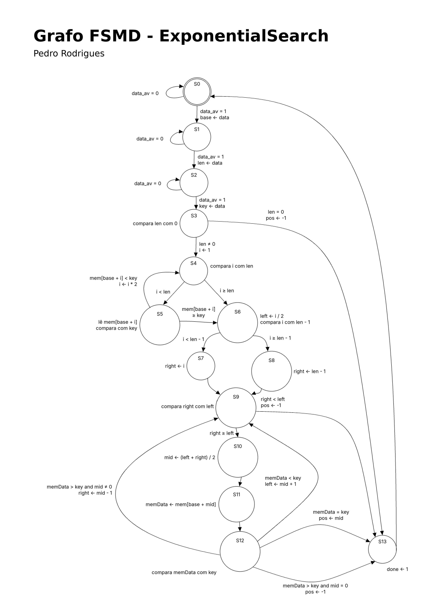
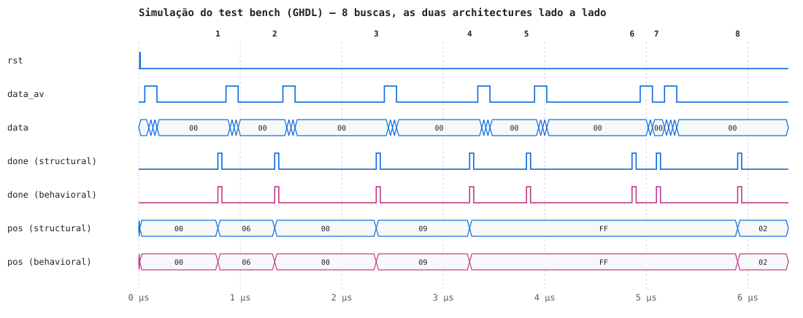

<div align="center">

# 🔎 ExponentialSearch em VHDL

**Processador dedicado que faz busca exponencial em um vetor ordenado guardado na memória.**


Pedro Rodrigues

</div>

---

## 📌 Sobre

Este projeto descreve em VHDL o circuito **ExponentialSearch**, projetado antes no Logisim (Parte 1 do trabalho de Sistemas Digitais II). O circuito é o equivalente em hardware desta função em C:

```c
int8_t exponential_search(int8_t array[], uint8_t len, int8_t key);
```

Ele foi descrito de **duas formas**, que têm exatamente o mesmo comportamento ciclo a ciclo:

| Arquitetura | Como é feita |
|---|---|
| `structural` | Bloco de controle (`ControlPath`) + bloco de dados (`DataPath`), ligados por records |
| `behavioral` | Um único `process` com `case` por estado, direto do grafo da FSMD |

## ⚙️ Como funciona

1. Recebe pela entrada `data`, um valor por ciclo com `data_av = 1`: **base** (endereço do vetor), **len** (tamanho) e **key** (valor buscado).
2. **Fase exponencial:** dobra `i` (1, 2, 4, 8, ...) até passar do fim do vetor ou achar `mem[base + i] >= key`.
3. **Fase binária:** busca binária entre `left = i/2` e `right = min(i, len - 1)`.
4. Devolve em `pos` a posição da chave, ou **-1 (`0xFF`)** se não achar, e sobe `done` por um ciclo.

### Interface

| Porta | Direção | Função |
|---|---|---|
| `clk`, `rst` | entrada | clock e reset assíncrono |
| `data`, `data_av` | entrada | dado de entrada (8 bits) e aviso de dado disponível |
| `pos` | saída | posição encontrada, ou `0xFF` |
| `done` | saída | fim da busca |
| `address`, `data_in`, `ce`, `wr` | memória | endereço, dado lido, habilita e escrita (sempre `0`: só lemos) |

## 🧱 Arquitetura `structural`

### Bloco de dados (`DataPath`)

- **Registradores de 8 bits:** `base`, `len`, `key`, `i`, `left`, `right`, `mid`, `memData` e `pos` (instâncias de `RegisterNbits`).
- **Somador 1 (`aluOp`):** calcula `base + i` / `base + mid`, `mid + 1`, `mid - 1`, `len - 1` e `left + right`.
- **Somador 2 (comparador, `cmpSel`):** faz `X - Y` e gera `EQ` (resultado = 0) e `GE` (bit de sinal = 0).
- **Só com fios:** `i × 2 = i(6 downto 0) & '0'` e `i / 2 = '0' & i(7 downto 1)`.

### Bloco de controle (`ControlPath`)

Máquina de estados com 14 estados (registrador de estado, lógica de próximo estado e saídas Moore/Mealy):

| Estado | O que faz |
|---|---|
| S0, S1, S2 | lê `base`, `len` e `key` (espera `data_av`) |
| S3 | se `len = 0`: `pos ← -1`; senão `i ← 1` |
| S4, S5 | fase exponencial: compara `i` com `len`, lê `mem[base + i]` e dobra `i` |
| S6, S7, S8 | prepara a busca binária: `left ← i/2`, `right ← i` ou `len - 1` |
| S9 | se `right < left`, não achou |
| S10, S11 | `mid ← (left + right)/2` e lê `mem[base + mid]` |
| S12 | compara com `key`: achou, vai para a esquerda ou para a direita |
| S13 | `done ← 1` e volta para S0 |

## 📈 Grafo da FSMD

<p align="center">
  
</p>

Versões para imprimir: [`FSMD_ExponentialSearch.pdf`](docs/FSMD_ExponentialSearch.pdf) (FSMD) e [`FSM_FSMD_ExponentialSearch.pdf`](docs/FSM_FSMD_ExponentialSearch.pdf) (FSM + FSMD com os sinais de controle).

## 🧪 Simulação

O test bench (`ExponentialSearch_tb`) instancia **as duas arquiteturas lado a lado**, cada uma com sua memória carregada do mesmo `image.txt`, e faz 8 buscas com os mesmos estímulos.

`image.txt` tem dois vetores: **vetor 1** nos endereços 0 a 9 (`-10, -5, 0, 3, 7, 12, 20, 30, 40, 50`) e **vetor 2** nos endereços 10 a 14 (`5, 10, 15, 20, 25`).

| # | base | len | key | pos | Caso testado |
|---|---|---|---|---|---|
| 1 | 0 | 10 | 20 | 6 | encontrado no meio |
| 2 | 0 | 10 | -10 | 0 | primeiro elemento |
| 3 | 0 | 10 | 50 | 9 | último elemento |
| 4 | 0 | 10 | 4 | -1 | não encontrado |
| 5 | 0 | 10 | -20 | -1 | menor que todos |
| 6 | 0 | 10 | 60 | -1 | maior que todos |
| 7 | 0 | 0 | 20 | -1 | vetor vazio |
| 8 | 10 | 5 | 15 | 2 | outro vetor (base ≠ 0) |

<p align="center">
  
</p>

As duas arquiteturas terminam cada busca no mesmo ciclo e com o mesmo resultado.

## ▶️ Como rodar no ModelSim

No console do ModelSim:

```tcl
cd caminho/para/exponential-search-vhdl/vhdl
do compile.tcl
vsim work.ExponentialSearch_tb
do wave.do
run 6 us
```

> A ordem de compilação importa (de baixo para cima), por isso use sempre o `compile.tcl`.

Para testar outro vetor, basta editar o `image.txt` (um valor hexadecimal por linha) e os estímulos `base`, `len` e `key` no test bench.

## 📂 Estrutura

```
exponential-search-vhdl/
├── vhdl/
│   ├── Util_pkg.vhd              funções auxiliares (do professor)
│   ├── Memory.vhd                memória carregada de image.txt (do professor)
│   ├── RegisterNbits.vhd         registrador de N bits (do professor)
│   ├── FullAdder.vhd             somador completo
│   ├── Adder_nbits.vhd           somador de N bits (for generate de FullAdders)
│   ├── ExponentialSearch_pkg.vhd records Command e Status
│   ├── DataPath.vhd              bloco de dados
│   ├── ControlPath.vhd           bloco de controle (FSM)
│   ├── ExponentialSearch.vhd     topo: architectures structural e behavioral
│   ├── ExponentialSearch_tb.vhd  test bench com as duas architectures
│   ├── image.txt                 conteúdo da memória
│   ├── compile.tcl               script de compilação do ModelSim
│   └── wave.do                   formas de onda do ModelSim
└── docs/
    ├── FSMD_ExponentialSearch.pdf
    ├── FSM_FSMD_ExponentialSearch.pdf
    └── img/
```

## 👤 Autor

**Pedro Rodrigues**

Trabalho da disciplina Sistemas Digitais II.
